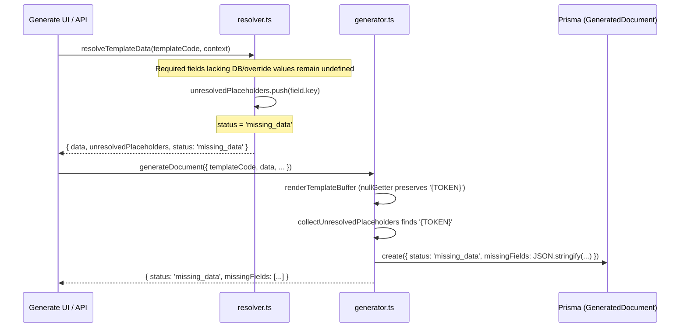
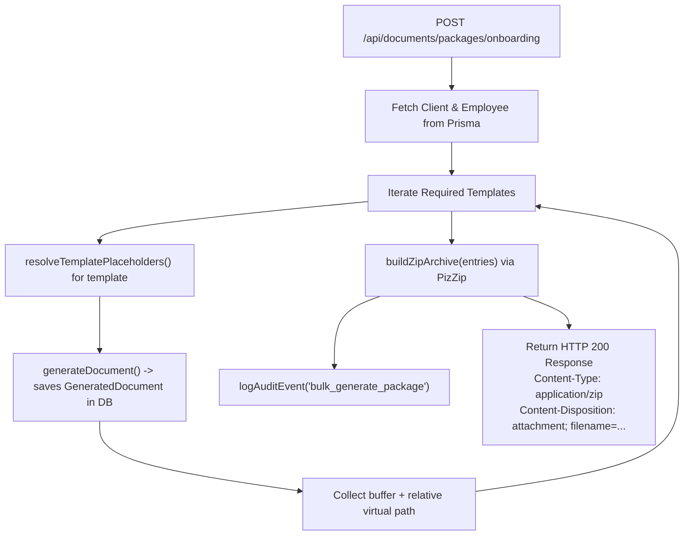

# Architectural Survey Report: Pillars 3, 4, and 5
**Strategic Modernization of Romanian SSM, Occupational Health, and HR Systems**
**Author:** `p_survey_explorer_3` (Explorer / Architect Agent)  
**Date:** 2026-11-04  
**Target Codebase:** `/Users/davidalexandru/Documents/Proiect_SSM`

---

## 1. Executive Summary

This architectural survey provides an exhaustive technical analysis and concrete implementation design for **Pillars 3, 4, and 5** of the Strategic Modernization Plan ([PLAN_STRATEGIC_SSM_IGIENA_HR.md](/Users/davidalexandru/.gemini/antigravity/brain/7f1f394f-32ac-4074-962e-c4dddf036503/PLAN_STRATEGIC_SSM_IGIENA_HR.md)).

### Scope & Key Findings
1. **Pillar 3 (Resolver & Real Data Plumbing):**
   - **Mock Data Audit:** Identified exact code locations in [`src/lib/templates/resolver.ts`](/Users/davidalexandru/Documents/Proiect_SSM/src/lib/templates/resolver.ts) where fake mock strings (`salary: '6500 lei'`, `CIM: 'CIM-2026-0042'`, hardcoded appointees, fake co-insured dependents) are injected via `ROMANIAN_LEGAL_HR_CIM` and `ROMANIAN_LEGAL_DECIZII`. Designed the decoupled architecture to transition to leaving unspecified transactional fields empty while retaining statutory normative defaults (e.g. 4-hour training durations, legal citations), routing empty required fields to the system's native `missing_data` state and flagging them in the UI.
   - **Default SEPP Provider & Specialist Fallback:** Found that lines 548–556 in `resolver.ts` bypass the database when a client lacks explicit `providerId`/`specialistId`, falling back to static strings. Mapped the query logic to retrieve `isDefault: true` records from `SsmProvider` and `SsmSpecialist`, ensuring custom business profiles configured in `/settings/provider` apply automatically.
   - **Job Model Integration:** Mapped `Job` model properties (`mainActivities`, `equipmentUsed`, `workConditions`, `corCode`) to corresponding tokens (`{PLACEHOLDER_ACTIVITATI_POST}`, `{PLACEHOLDER_ECHIPAMENTE_POST}`, `{PLACEHOLDER_CONDITII_POST}`, `{PLACEHOLDER_COD_COR}`) and specified additions to [`definitions.ts`](/Users/davidalexandru/Documents/Proiect_SSM/src/lib/templates/definitions.ts).
   - **Dynamic Prevention Plan:** Designed the correlation mechanism between `caen-risk-presets.ts` and `risk-plan-prevenire-tesa`, replacing the 19 rigid office measures with CAEN-tailored technical and organizational measures.

2. **Pillar 4 (Bulk Generation Packages / ZIP Workflows):**
   - **1-Click ZIP Workflows:** Defined technical blueprints for:
     - **Pachet Onboarding Salariat** (Cerere angajare + Fișă trimitere medicină Anexa 2 + Fișă factori risc Anexa 3 + CIM Model 2022 + Informare GDPR + Luare cunoștință RI + Anexă SSM fișă post).
     - **Pachet Înființare Dosar SSM Client** (Pachet Decizii 01–11 + Dosar Evaluare Riscuri + Plan Prevenire + Evidență Zone Pericol + Plan Pericol Grav și Iminent + Tematici Generale 4h + OPIS IPSSM + Pachet IPSSM 01–13).
     - **Export Arhivă Control ITM / ISU** (6-folder structured directory tree ready for inspection).
   - **ZIP Engine Selection:** Evaluated `pizzip` vs `jszip` vs `archiver`. Established that `pizzip` is **already installed** (`pizzip: ^3.3.0` in `package.json`), natively supports multi-file directory structures in memory (`docZip.file("dir/file.docx", buffer)`), produces zero dependency bloat, and eliminates React 19/Turbopack compatibility risks.
   - **API Routes & UI Triggers:** Formulated endpoints (`/api/documents/packages/...`) and UI triggers in `/clients/[id]` and `/employees`.

3. **Pillar 5 (UI/UX Refinements & Verification):**
   - **Job Selector (`jobId`) in `/documents/generate`:** Identified that `/documents/generate/page.tsx` currently lacks a `JobOption` state and forces an `employeeId` even for job-level documents (`contextLevel === 'job'`). Designed the client-side job selector and decoupled validation logic.
   - **Interactive Risk Configurator in `/risk-assessments`:** Redesigned `/risk-assessments/page.tsx` from an 84-line static view into a visual configurator with CAEN & Job selection, live Pece gravity (1–7) & probability (1–6) adjustment, real-time $N_{rg} \le 3.50$ calculation, and 1-click DOCX generation.
   - **Verification Suite & Scripts:** Audited [`scripts/verify-all.ts`](/Users/davidalexandru/Documents/Proiect_SSM/scripts/verify-all.ts) (currently 130 items across 5 suites). Outlined required updates for 31-template coverage, adding `"test": "npx tsx scripts/verify-all.ts"` in `package.json`, and validating `npm run build`.

---

## 2. Pillar 3: Resolver & Real Data Plumbing Architecture

### 2.1. Audit of Mock Data Injection & Elimination Strategy

#### Current Codebase Inspection
In [`src/lib/templates/resolver.ts`](/Users/davidalexandru/Documents/Proiect_SSM/src/lib/templates/resolver.ts), data merging occurs at lines 962–967:
```typescript
const mergedData: Record<string, unknown> = {
  ...ALL_ROMANIAN_LEGAL_FALLBACKS,
  ...verifiedMap,
  ...(context.customOverrides || {}),
};
```
Because `ALL_ROMANIAN_LEGAL_FALLBACKS` acts as the foundational layer, any token defined therein is pre-populated with mock data. Specifically:

| File & Lines | Mock Token | Injected Mock Value | Statutory / Business Reality |
|:---|:---|:---|:---|
| `resolver.ts:286` | `PLACEHOLDER_SALARIU_BRUT` | `'6500 lei'` | Fictitious salary! Must be provided by client/contract or left blank. |
| `resolver.ts:280` | `PLACEHOLDER_NUMAR_CIM` | `'CIM-2026-0042'` | Fictitious contract number! Must come from employment data or user input. |
| `resolver.ts:287` | `PLACEHOLDER_DATA_PLATA` | `'data de 15 a fiecărei luni...'` | Company-specific payroll date. |
| `resolver.ts:288` | `PLACEHOLDER_ALTE_DREPTURI_SALARIALE` | `'Tichete de masă conform Legii 165/2018...'` | Specific to collective/individual labor agreement. |
| `resolver.ts:289` | `PLACEHOLDER_ZILE_CONCEDIU` | `'21 de zile lucrătoare'` | Statutory minimum is 20 days, varied by company policy. |
| `resolver.ts:290` | `PLACEHOLDER_ZILE_PROBA` | `'90 de zile calendaristice...'` | Negotiable up to 90 days (execution) or 120 days (management). |
| `resolver.ts:291` | `PLACEHOLDER_ZILE_PREAVIZ_DEMISIONARE` | `'20 de zile lucrătoare...'` | Max 20 execution, 45 management. |
| `resolver.ts:294-306`| `PLACEHOLDER_NUME_COMPLET_PERSOANA_01..02` | `'-'` | Dependent tax deduction slots. |
| `resolver.ts:73-82` | `PLACEHOLDER_NUMAR_DECIZIE_01..11` | `'01/15.01.2026'`, etc. | Hardcoded numbering format with fixed date. |
| `resolver.ts:83-86` | `PLACEHOLDER_LUCRATOR_DESEMNAT_SSM`, etc. | `'Ing. Mihai Popescu'`, etc. | Hardcoded names of individuals. |
| `resolver.ts:91-110`| `PLACEHOLDER_NUMAR_PERMIS_FOC`, etc. | `'01/2026'`, `'Vasile Ionescu'` | Fictitious hot work permit execution data. |

#### Architectural Decoupling: Statutory Defaults vs. Transactional Variables
We must establish a clean architectural taxonomy:
1. **Statutory Legal Constants (Retain):**
   - Standard legal citations: `PLACEHOLDER_ORDIN_APLICABIL` (`'Ordinul comun MS/ME nr. 2209/4469/2022'`), `PLACEHOLDER_DURATA_INSTRUIRE` (`'4 ore'`), standard IPSSM titles, Pece matrix calculations.
2. **Transactional & Personal Variables (Eliminate Mock Defaults):**
   - Salary, CIM number, decision numbers, employee personal details, appointees, hot work permit data.
   - When these are not present in the database and not passed via `customOverrides`, they must evaluate to `undefined` / `''`.

#### State Propagation to `missing_data`
Tracing the data lifecycle across the engine:


In [`src/lib/templates/generator.ts`](/Users/davidalexandru/Documents/Proiect_SSM/src/lib/templates/generator.ts):
- Lines 328–333 configure `nullGetter: (part) => (part.value ? `{${part.value}}` : '')`.
- Lines 582–590 execute `collectUnresolvedPlaceholders(outputBuffer, templateFormat)`. If any `{PLACEHOLDER_...}` remains in the document XML, it is automatically added to `missingFields`, setting `status: 'missing_data'`.
- In the database, `GeneratedDocument.status` correctly stores `'missing_data'`, and `missingFields` stores the JSON array of labels requiring operator attention.

---

### 2.2. Relational SEPP Provider & Specialist Dynamic Fallback

#### Problem Analysis
In `prisma/schema.prisma`:
```prisma
model SsmProvider {
  id        String   @id @default(uuid())
  name      String
  cui       String   @unique
  isDefault Boolean  @default(false)
  isActive  Boolean  @default(true)
  ...
}

model SsmSpecialist {
  id         String      @id @default(uuid())
  providerId String
  provider   SsmProvider @relation(fields: [providerId], references: [id], onDelete: Cascade)
  name       String
  isDefault  Boolean     @default(false)
  isActive   Boolean     @default(true)
  ...
}

model Client {
  id           String         @id @default(uuid())
  providerId   String?
  provider     SsmProvider?   @relation(fields: [providerId], references: [id])
  specialistId String?
  specialist   SsmSpecialist? @relation(fields: [specialistId], references: [id])
  ...
}
```

In `resolver.ts:548–556`:
```typescript
// CURRENT FLAWED LOGIC:
let prov = client?.provider;
let spec = client?.specialist;

if (!prov && client?.providerId) {
  prov = await prisma.ssmProvider.findUnique({ where: { id: client.providerId } });
}
if (!spec && client?.specialistId) {
  spec = await prisma.ssmSpecialist.findUnique({ where: { id: client.specialistId } });
}
// If client.providerId is null, prov remains null, falling back to static strings!
```

#### Proposed Fallback Algorithm
The resolver must query the default provider and specialist if no explicit link exists:

```typescript
// RECOMMENDED RESOLUTION LOGIC:
let prov = client?.provider;
let spec = client?.specialist;

if (!prov && client?.providerId) {
  prov = await prisma.ssmProvider.findUnique({ where: { id: client.providerId } });
}
// Fallback to isDefault provider if client has no provider linked
if (!prov) {
  prov = await prisma.ssmProvider.findFirst({
    where: { isDefault: true, isActive: true },
    include: { specialists: true },
  });
}

if (!spec && client?.specialistId) {
  spec = await prisma.ssmSpecialist.findUnique({ where: { id: client.specialistId } });
}
// Fallback to isDefault specialist for the provider (or system default)
if (!spec && prov) {
  spec = await prisma.ssmSpecialist.findFirst({
    where: { providerId: prov.id, isDefault: true, isActive: true },
  });
}
if (!spec) {
  spec = await prisma.ssmSpecialist.findFirst({
    where: { isDefault: true, isActive: true },
  });
}
```

This guarantees that when an operator customizes the company's SEPP profile in `/settings/provider` (e.g. changing authorization number or adding a new specialist), all documents generated across all clients immediately reflect the real database records without requiring manual client re-binding.

---

### 2.3. Integration of `Job` Model Metadata into Document Tokens

#### Schema Audit
In [`prisma/schema.prisma`](/Users/davidalexandru/Documents/Proiect_SSM/prisma/schema.prisma) (lines 159–178):
```prisma
model Job {
  id              String   @id @default(uuid())
  clientId        String
  title           String   // Funcție / post
  corCode         String?  // Cod COR opțional
  mainActivities  String?  // Activități principale
  equipmentUsed   String?  // Echipamente/utilaje folosite
  workConditions  String?  // Condiții de lucru relevante
  workersCount    Int?     // Număr aproximativ lucrători
  isActive        Boolean  @default(true)
}
```

#### Missing Token Mappings in `resolver.ts`
Currently, `resolver.ts` only maps `PLACEHOLDER_FUNCTIE: job?.title` and `PLACEHOLDER_COD_COR: job?.corCode || '251201'`. The rich occupational context is completely ignored.

To resolve this, the following mappings must be integrated into `verifiedMap`:
```typescript
// In resolver.ts -> verifiedMap:
PLACEHOLDER_ACTIVITATI_POST: 
  (context.customOverrides?.PLACEHOLDER_ACTIVITATI_POST as string) ||
  job?.mainActivities || 
  '',

PLACEHOLDER_ECHIPAMENTE_POST: 
  (context.customOverrides?.PLACEHOLDER_ECHIPAMENTE_POST as string) ||
  job?.equipmentUsed || 
  '',

PLACEHOLDER_CONDITII_POST: 
  (context.customOverrides?.PLACEHOLDER_CONDITII_POST as string) ||
  job?.workConditions || 
  '',

PLACEHOLDER_COD_COR: 
  (context.customOverrides?.PLACEHOLDER_COD_COR as string) ||
  job?.corCode || 
  '',
```

#### Affected Template Definitions in [`definitions.ts`](/Users/davidalexandru/Documents/Proiect_SSM/src/lib/templates/definitions.ts)
These tokens must be registered in the catalog manifest for:
1. `hr-anexa-fisa-post` (`Anexa fisa postului SSM.docx`):
   - Add fields: `PLACEHOLDER_FIRMA`, `PLACEHOLDER_CUI`, `PLACEHOLDER_FUNCTIE`, `PLACEHOLDER_COD_COR`, `PLACEHOLDER_ACTIVITATI_POST`, `PLACEHOLDER_ECHIPAMENTE_POST`, `PLACEHOLDER_CONDITII_POST`, `PLACEHOLDER_NUMAR_CIM`.
2. `training-detaliu-loc-munca` (`Detaliu Tematica loc de munca.docx`):
   - Add fields: `PLACEHOLDER_FIRMA`, `PLACEHOLDER_FUNCTIE`, `PLACEHOLDER_ACTIVITATI_POST`, `PLACEHOLDER_ECHIPAMENTE_POST`.
3. `training-tematica-loc-munca` (`Tematica loc de munca.docx`):
   - Add fields: `PLACEHOLDER_ACTIVITATI_POST`, `PLACEHOLDER_ECHIPAMENTE_POST`, `PLACEHOLDER_CONDITII_POST`.

---

### 2.4. Dynamic Correlation of Prevention Plan Measures with `caen-risk-presets.ts`

#### Current Deficiency
In `Plan de Prevenire TESA.docx` (`risk-plan-prevenire-tesa`), 19 measures are hardcoded as static text describing ergonomics and office computer screens. If generated for an operational post (cook, driver, welder), the plan remains an office plan, constituting a statutory violation under Legea 319/2006 art. 13 lit. b.

#### Preset Architecture in `caen-risk-presets.ts`
Each CAEN profile (`6201`, `5610`, `4120`, `4711`, `4941`, `7022`, `8621`) defines `RiskPresetItem` entries with tailored `preventionMeasures: string[]`:
- **CAEN 5610 (Restaurante):** Protective mesh gloves for butchery/slicing, anti-slip footwear SRC certified, temperature monitoring of frying oils, daily kitchen ventilation cleaning.
- **CAEN 4120 (Construcții):** Full-body safety harnesses, edge protection handrails, 30mA RCD site power panels, ear defenders around heavy equipment.
- **CAEN 4941 (Transport Rutier):** Pre-trip vehicle inspection checklist, strict adherence to tachograph driving hours (Regulamentul CE 561/2006), cargo tie-down ratchet straps.

#### Prevention Plan Resolution Engine
In `resolver.ts`, `resolveTemplateData` must extract and format measures dynamically:
```typescript
// Dynamic Prevention Plan measures extraction
const resolvedMeasures: Array<{
  index: number;
  hazard: string;
  measureDescription: string;
  measureType: 'tehnica' | 'organizatorica' | 'igienico-sanitara';
  responsible: string;
  deadline: string;
}> = [];

let measureIdx = 1;
for (const factor of riskProfile.factors) {
  for (const m of factor.preventionMeasures) {
    const isTehnica = /echipament|ventil|instal|aparat|protect|bariera|panou|cablu/i.test(m);
    const isIgienica = /igien|medical|apa|pauza|spal|sanitar/i.test(m);
    
    resolvedMeasures.push({
      index: measureIdx,
      hazard: factor.riskFactor,
      measureDescription: m,
      measureType: isTehnica ? 'tehnica' : isIgienica ? 'igienico-sanitara' : 'organizatorica',
      responsible: isTehnica ? 'Conducător loc de muncă / Șef tehnic' : 'Lucrător desemnat SSM / Administrator',
      deadline: 'Permanent / Conform scadențarului',
    });
    measureIdx++;
  }
}

// Map both as structured array (for loop templates) and indexed tokens (PLACEHOLDER_MASURA_PREVENIRE_01..30)
const dynamicMeasuresMap: Record<string, string> = {};
resolvedMeasures.slice(0, 30).forEach((m, i) => {
  const pad = String(i + 1).padStart(2, '0');
  dynamicMeasuresMap[`PLACEHOLDER_MASURA_${pad}`] = m.measureDescription;
  dynamicMeasuresMap[`PLACEHOLDER_TIP_MASURA_${pad}`] = m.measureType;
  dynamicMeasuresMap[`PLACEHOLDER_RESPONSABIL_MASURA_${pad}`] = m.responsible;
  dynamicMeasuresMap[`PLACEHOLDER_TERMEN_MASURA_${pad}`] = m.deadline;
});
```

---

## 3. Pillar 4: Bulk Generation Packages (ZIP Workflows)

### 3.1. Architectural Specification of the 3 Workflows

```
┌────────────────────────────────────────────────────────────────────────────────────────┐
│                        SPECIFICAȚIILE CELOR 3 PACHETE BULK (ZIP)                       │
├────────────────────────────┬─────────────────────────────┬─────────────────────────────┤
│ Pachet Onboarding Salariat │ Înființare Dosar SSM Client │ Arhivă Control ITM / ISU    │
│ (1-Click Onboarding ZIP)   │ (Start-up Dossier ZIP)      │ (Audit & Inspection ZIP)    │
├────────────────────────────┼─────────────────────────────┼─────────────────────────────┤
│ Context: Client + Employee │ Context: Client (+ Posturi) │ Context: Client (+ Toate)   │
├────────────────────────────┼─────────────────────────────┼─────────────────────────────┤
│ 1. Cerere Angajare         │ 1. Decizii Organizatorice   │ 01_Acte_Societate_Decizii/  │
│ 2. Anexa 2 Trimitere Med.  │ 2. Dosar Evaluare Riscuri   │ 02_Evaluare_Riscuri_Plan/   │
│ 3. Anexa 3 Factori Risc    │ 3. Plan Prevenire Protecție │ 03_Instructiuni_Proprii_SSM/│
│ 4. CIM Model-Cadru 2022    │ 4. Zone cu Risc Ridicat     │ 04_Tematici_Instruire/      │
│ 5. Informare GDPR          │ 5. Plan Acțiune Urgență     │ 05_Dosare_Salariati/        │
│ 6. Declarație RI           │ 6. Tematică Introductivă 4h │ 06_Medicina_Muncii_Igiena/  │
│ 7. Anexă SSM Fișă Post     │ 7. Detaliu Tematică Introd. │                             │
│ 8. Fișă SSM Anexa 11       │ 8. OPIS IPSSM               │                             │
│ 9. Fișă EIP HG 1048        │ 9. IPSSM 01-13 (Complet)    │                             │
└────────────────────────────┴─────────────────────────────┴─────────────────────────────┘
```

#### Detailed Composition:
1. **Pachet Onboarding Salariat (1-Click ZIP):**
   - Single salariat context: `clientId` + `employeeId`.
   - Generates all documents required on day 1 before job admittance:
     - `hr-cerere-angajare` (Cerere de angajare)
     - `med-fisa-solicitare-examen` (Fișă solicitare examen medical - Anexa 2 HG 355/2007)
     - `med-fisa-identificare-riscuri` (Fișă identificare factori risc - Anexa 3 HG 355/2007)
     - `hr-cim-model-cadru-2022` / `hr-cim-2026` (Contract individual de muncă)
     - `hr-gdpr-informare` (Informare protecția datelor)
     - `hr-declaratie-regulament` (Declarație luare la cunoștință Regulament Intern)
     - `hr-anexa-fisa-post` (Anexă SSM la fișa de post)
     - `ssm-fisa-instruire-individuala` (Fișa Individuală de Instruire SSM - Anexa 11 HG 1425/2006)
     - `eip-fisa-acordare-individuala` (Fișă individuală acordare EIP conform HG 1048/2006)

2. **Pachet Înființare Dosar SSM Client (Start-up Dossier ZIP):**
   - Client context: `clientId`.
   - Generates the complete organizational foundation for a newly contracted company:
     - `decizii-angajator` (Pachet Decizii 01–11)
     - `risk-evaluare` (Dosar Evaluarea Riscurilor)
     - `risk-plan-prevenire-tesa` (Planul de Prevenire și Protecție)
     - `risk-zone-pericol` (Evidența zonelor cu risc ridicat și specific)
     - `risk-plan-actiune-urgenta` (Plan acțiune pericol grav și iminent)
     - `training-tematica-introductiv` (Tematică instruire introductiv-generală 4h)
     - `training-detaliu-introductiv` (Detaliu tematică introductiv-generală)
     - `ipssm-opis` (OPIS instrucțiuni proprii)
     - `ipssm-universale` (IPSSM 01-10 Generale)
     - `ipssm-alunecari` (IPSSM 11)
     - `ipssm-autovehicule` (IPSSM 12)
     - `ipssm-birou` (IPSSM 13)

3. **Export Arhivă Control ITM / ISU (ZIP):**
   - Formatted for immediate handoff to ITM / ISU labor inspectors:
     - `01_Acte_Societate_si_Decizii/`: Decizii angajator, date abilitare SEPP, certificat atestare evaluator.
     - `02_Evaluare_Riscuri_si_Prevenire/`: Evaluare riscuri, plan de prevenire și protecție, zone de risc ridicat.
     - `03_Instructiuni_Proprii_SSM/`: OPIS și colecția completă de instrucțiuni proprii.
     - `04_Tematici_si_Instruire/`: Tematici introductiv-generale și la locul de muncă.
     - `05_Dosare_Salariati/`: Subdirectoare per salariat (`Popescu_Ion/`, `Ionescu_Vasile/`) cu CIM, fișe post, declarații.
     - `06_Medicina_Muncii_si_Igienei/`: Fișe de solicitare examen medical, anexe și cataloage igienă DSP.

---

### 3.2. Evaluation of ZIP Generation Mechanisms

We evaluated three potential technical approaches:

| Mechanism | Packages Needed | Bundle Size / Impact | Streaming Support | Memory & CPU Efficiency | Recommendation |
|:---|:---|:---|:---|:---|:---|
| **PizZip** | **None** (already in `package.json`: `pizzip: ^3.3.0`) | 0 KB added | Buffer / In-Memory (`generate({ type: 'nodebuffer' })`) | Excellent for archives under 50 MB; synchronous generation in < 300ms | **PRIMARY CHOICE** (Zero risk, zero dependency overhead) |
| **JSZip** | `jszip`, `@types/jszip` | ~120 KB | Promise-based stream / buffer | Identical engine to PizZip | Redundant given PizZip presence |
| **Archiver** | `archiver`, `@types/archiver` | ~450 KB + subdeps | Node.js WritableStream pipe | Best for multi-gigabyte files | Unnecessary overhead for 5–15 MB Office document bundles |

#### Architecture of `zip-bundler.ts`
We design a dedicated service utility at `src/lib/templates/zip-bundler.ts`:
```typescript
import PizZip from 'pizzip';

export interface ZipArchiveEntry {
  path: string; // e.g. "01_Acte_Societate/Decizii.docx"
  buffer: Buffer;
}

export function buildZipArchive(entries: ZipArchiveEntry[]): Buffer {
  const zip = new PizZip();
  for (const entry of entries) {
    zip.file(entry.path, entry.buffer);
  }
  return zip.generate({
    type: 'nodebuffer',
    compression: 'DEFLATE',
    compressionOptions: { level: 6 },
  });
}
```

---

### 3.3. API Routes Design & Endpoints

#### Route Architecture
We establish clean API route handlers under `src/app/api/documents/packages/`:
1. `POST /api/documents/packages/onboarding/route.ts`
   - Request Body:
     ```json
     {
       "clientId": "uuid",
       "employeeId": "uuid",
       "operatorName": "Operator Intern",
       "customFields": {}
     }
     ```
2. `POST /api/documents/packages/startup/route.ts`
   - Request Body:
     ```json
     {
       "clientId": "uuid",
       "operatorName": "Operator Intern",
       "customFields": {}
     }
     ```
3. `POST /api/documents/packages/itm-control/route.ts`
   - Request Body:
     ```json
     {
       "clientId": "uuid",
       "includeEmployees": true,
       "operatorName": "Operator Intern"
     }
     ```

#### Execution Pipeline per Bulk Route


#### Dual-Benefit Outcome:
1. **Direct Download:** The user receives a `.zip` archive immediately in the browser.
2. **Audit & Traceability:** Every individual document in the bundle is saved to `GeneratedDocument` in the database, has its missing fields inspected, and creates an `AuditEvent`, ensuring full compliance history.

---

### 3.4. UI Triggers & Integration Points

1. **Client Detail Page ([`src/app/clients/[id]/page.tsx`](/Users/davidalexandru/Documents/Proiect_SSM/src/app/clients/[id]/page.tsx)):**
   - Add a primary actions bar in the overview card:
     - Button: `⚡ Pachet Înființare Dosar SSM (ZIP)` -> Triggers `/api/documents/packages/startup`.
     - Button: `🏛️ Export Arhivă Control ITM / ISU (ZIP)` -> Triggers `/api/documents/packages/itm-control`.
2. **Employees Registry ([`src/app/employees/employee-registry-client.tsx`](/Users/davidalexandru/Documents/Proiect_SSM/src/app/employees/employee-registry-client.tsx)):**
   - In table rows (lines 529–552), alongside individual links ("Cerere", "Declarație", "CIM"), add:
     - Button: `⚡ Onboarding ZIP` -> Downloads the complete employee onboarding pack in 1 click!

---

## 4. Pillar 5: UI/UX Refinements & Verification Architecture

### 4.1. Job Selector (`jobId`) in `/documents/generate`

#### Codebase Analysis
In [`src/app/documents/generate/page.tsx`](/Users/davidalexandru/Documents/Proiect_SSM/src/app/documents/generate/page.tsx):
- Lines 20–64 define interfaces `ClientOption`, `TemplateOption`, `EmployeeOption`, `HygieneSessionOption`. **`JobOption` is missing.**
- Lines 157–159 determine employee requirement:
  ```typescript
  const isEmployeeRequired =
    !isHygieneTemplate &&
    (currentTemplate?.contextLevel === 'employee' || currentTemplate?.contextLevel === 'job');
  ```
  This mistakenly requires selecting an employee even for post-level documents (`contextLevel === 'job'`), such as `Tematica loc de munca` or `Anexa fisa postului SSM`.
- The backend API (`/api/documents/generate/route.ts:13` and `/api/templates/[code]/fields/route.ts:13`) **already supports `jobId`**, but the UI never renders a selector or passes `jobId`!

#### UI/UX Implementation Plan
1. **Define `JobOption`:**
   ```typescript
   interface JobOption {
     id: string;
     title: string;
     corCode?: string | null;
     mainActivities?: string | null;
     equipmentUsed?: string | null;
   }
   ```
2. **State & Fetching:**
   - Add state: `const [jobs, setJobs] = useState<JobOption[]>([]);` and `const [selectedJobId, setSelectedJobId] = useState<string>('');`.
   - When `selectedClientId` changes, fetch client jobs (or read from `/api/clients/${selectedClientId}`).
3. **Decouple Validation:**
   - If `currentTemplate?.contextLevel === 'job'`, either `selectedJobId` OR `selectedEmployeeId` is acceptable.
   - If `selectedEmployeeId` is selected, auto-select their current job in the dropdown while allowing manual override.
4. **Render Job Selector Dropdown:**
   - Render when client is selected, placed next to the Employee selector with an informative badge (`Post / Funcție`).
5. **Pass `jobId` to API:**
   - Include `jobId: selectedJobId || undefined` in field queries and document generation requests.

---

### 4.2. Interactive Risk Assessment Configurator in `/risk-assessments`

#### Current Status
[`src/app/risk-assessments/page.tsx`](/Users/davidalexandru/Documents/Proiect_SSM/src/app/risk-assessments/page.tsx) is currently an 84-line static server component displaying cards for existing assessments in Prisma. It lacks any interactive editing or factor manipulation.

#### Architectural Specification for Interactive Configurator
Transform `/risk-assessments` (or add a client component `/risk-assessments/new` or modal configurator) with the following features:

```
┌────────────────────────────────────────────────────────────────────────────────────────┐
│             CONFIGURATOR VIZUAL EVALUARE RISCURI SSM (METODA INCDPM PECE)              │
├────────────────────────────────────────────────────────────────────────────────────────┤
│ [ Selectează Client: NEXUS SOLUTIONS SRL ▼ ]  [ Post: Tehnician Mentenanță ▼ ]         │
│ [ Profil CAEN: 6201 - Tehnologia Informației ▼ ] [ Metoda: INCDPM București (Pece) ]   │
├────────────────────────────────────────────────────────────────────────────────────────┤
│ METRICI GLOBALE LIVE:                                                                  │
│ Nivel Global de Risc: [ 2.62 / 7.00 ]  Status: [ ✓ ACCEPTABIL (Nrg <= 3.50) ]          │
│ Factori: 30 total (17 x Nivel 3, 4 x Nivel 2, 9 x Nivel 1)                             │
├────────────────────────────────────────────────────────────────────────────────────────┤
│ TABEL FACTORI DE RISC (Editabil interactiv):                                           │
│ Sub-sistem │ Factor de Risc Identificat │ Gravitate (1-7) │ Probabilitate (1-6) │ Risc │
│ EXECUTANT  │ Intervenții electrice      │ [ 7 - Deces  ▼] │ [ 1 - Extrem rară ▼]│ [3]  │
│ SARCINA    │ Lucru prelungit ecran      │ [ 2 - ITM    ▼] │ [ 4 - Frecventă   ▼]│ [2]  │
│ MIJLOACE   │ Cabluri pe căi de acces    │ [ 3 - ITM    ▼] │ [ 4 - Frecventă   ▼]│ [3]  │
│ MEDIU      │ Curenți de aer / climat    │ [ 2 - ITM    ▼] │ [ 2 - Foarte rară ▼]│ [1]  │
├────────────────────────────────────────────────────────────────────────────────────────┤
│ ACȚIUNI:                                                                               │
│ [ 💾 Salvează în Baza de Date ]   [ 📄 Generează Raport DOCX ]  [ 📋 Generează Plan ]  │
└────────────────────────────────────────────────────────────────────────────────────────┘
```

#### Technical Components:
1. **Mathematical Live Calculations:**
   - $R_i = \text{PECE\_RISK\_MATRIX}[G_i - 1][P_i - 1]$ (implemented via `calculatePecePartialRisk`).
   - $N_{rg} = \frac{\sum_{i=1}^n R_i^2}{\sum_{i=1}^n R_i}$ (implemented via `calculateGlobalRiskScore`).
   - Live color badges:
     - $R_i = 1$: Verde deschis (`bg-emerald-50 text-emerald-700`)
     - $R_i = 2$: Galben (`bg-amber-50 text-amber-700`)
     - $R_i = 3$: Portocaliu (`bg-orange-50 text-orange-700`)
     - $R_i \ge 4$: Roșu (`bg-rose-50 text-rose-700`)
2. **API Endpoint:**
   - `POST /api/risk-assessments`: Creates `RiskAssessment`, inserts `RiskItem`s, and populates `PreventionMeasure`s.
3. **DOCX Generation Trigger:**
   - Once saved, invokes `/api/documents/generate` for `risk-evaluare` and `risk-plan-prevenire-tesa` passing the customized assessment data as snapshot overrides.

---

### 4.3. Verification Suite & Quality Gate

#### Structure of [`scripts/verify-all.ts`](/Users/davidalexandru/Documents/Proiect_SSM/scripts/verify-all.ts)
The master verification gate executes 5 sub-suites:

```
┌──────────────────────────────────────────────────────────────────────────────────────────┐
│                               MASTER VERIFICATION SUITE MATRIX                           │
├────┬─────────────────────────────┬────────────────────────────────────┬───────┬──────────┤
│ #  │ Suite Name                  │ Sub-Process Command                │ Scope │ Required │
├────┼─────────────────────────────┼────────────────────────────────────┼───────┼──────────┤
│ 1  │ Document Auto-Completion    │ npx tsx test-all-templates-gen.ts  │ 25*   │ 25/25    │
│ 2  │ Compliance Deadlines Engine │ npx tsx verify-compliance.ts       │ 45    │ 45/45    │
│ 3  │ Excel Import/Export         │ npx tsx verify-excel-import-exp.ts │ 6     │ 6/6      │
│ 4  │ Comprehensive E2E Suite     │ npx tsx e2e-suite.ts               │ 53    │ 53/53    │
│ 5  │ Production Build            │ npm run build                      │ 1     │ 1/1      │
├────┴─────────────────────────────┴────────────────────────────────────┴───────┴──────────┤
│ TOTAL VERIFIED ITEMS:                                                 │ 130   │ 130/130  │
└──────────────────────────────────────────────────────────────────────────────────────────┘
```
*\*Note: When Pillar 2 adds the 6 new templates, Suite 1 must be adjusted to verify 31/31 templates, raising the master gate to 136 items.*

#### Necessary Configuration Enhancements:
1. **Add `test` script in `package.json`:**
   ```json
   "scripts": {
     "dev": "next dev",
     "build": "next build",
     "start": "next start",
     "lint": "eslint",
     "test": "npx tsx scripts/verify-all.ts"
   }
   ```
2. **Turbopack & TypeScript Integrity:**
   Ensure all new API routes and components compile with zero TypeScript errors under Next.js 16 (`next build`).

---

## 5. Detailed Implementation Checklist for Development Workers

### For Pillar 3 (Resolver & Real Data):
- [ ] In `src/lib/templates/resolver.ts`:
  - [ ] Separate `ROMANIAN_LEGAL_HR_CIM` into statutory defaults vs. transactional fields. Remove fake salary `6500 lei` and placeholder CIM `CIM-2026-0042`.
  - [ ] Implement fallback query to `prisma.ssmProvider.findFirst({ where: { isDefault: true, isActive: true } })` and matching `SsmSpecialist` when `client.providerId` is null.
  - [ ] Map `job.mainActivities` $\rightarrow$ `{PLACEHOLDER_ACTIVITATI_POST}`.
  - [ ] Map `job.equipmentUsed` $\rightarrow$ `{PLACEHOLDER_ECHIPAMENTE_POST}`.
  - [ ] Map `job.workConditions` $\rightarrow$ `{PLACEHOLDER_CONDITII_POST}`.
  - [ ] Map `job.corCode` $\rightarrow$ `{PLACEHOLDER_COD_COR}`.
  - [ ] Add honorific helpers (`Dl.` / `Dna.`) for `{PLACEHOLDER_APELATIV_ADMINISTRATOR}` and `{PLACEHOLDER_APELATIV_PSI}`.
  - [ ] Implement dynamic extraction of prevention measures from `caen-risk-presets.ts` for `risk-plan-prevenire-tesa`.
- [ ] In `src/lib/templates/definitions.ts`:
  - [ ] Register new fields in catalog definitions for `hr-anexa-fisa-post`, `training-detaliu-loc-munca`, and `training-tematica-loc-munca`.

### For Pillar 4 (Bulk Packages):
- [ ] Create `src/lib/templates/zip-bundler.ts` using `PizZip` to package files and directories into a Node `Buffer`.
- [ ] Create `src/app/api/documents/packages/onboarding/route.ts` for 1-Click employee onboarding package.
- [ ] Create `src/app/api/documents/packages/startup/route.ts` for client SSM startup dossier.
- [ ] Create `src/app/api/documents/packages/itm-control/route.ts` for multi-folder inspection archive.
- [ ] Add UI trigger buttons in `/clients/[id]` and in `/employees`.

### For Pillar 5 (UI/UX & Verification):
- [ ] In `src/app/documents/generate/page.tsx`:
  - [ ] Add `JobOption` interface and state.
  - [ ] Load client jobs on client selection.
  - [ ] Render Job `<select>` dropdown.
  - [ ] Decouple employee requirement so selecting a Job satisfies `contextLevel === 'job'`.
  - [ ] Send `jobId` in `/api/templates/[code]/fields` query and `/api/documents/generate` POST body.
- [ ] In `src/app/risk-assessments/`:
  - [ ] Build interactive configurator with CAEN & Job selection.
  - [ ] Connect interactive sliders for gravity (1–7) and probability (1–6) with live Pece calculation ($R_i$ and $N_{rg}$).
  - [ ] Add `POST /api/risk-assessments` persistence endpoint and 1-click DOCX generation.
- [ ] In `package.json` and `scripts/`:
  - [ ] Add `"test": "npx tsx scripts/verify-all.ts"` to `package.json`.
  - [ ] Update `scripts/verify-all.ts` and `scripts/test-all-templates-generation.ts` to accommodate catalog expansion.
  - [ ] Verify `npm run build` succeeds cleanly with 0 errors.
